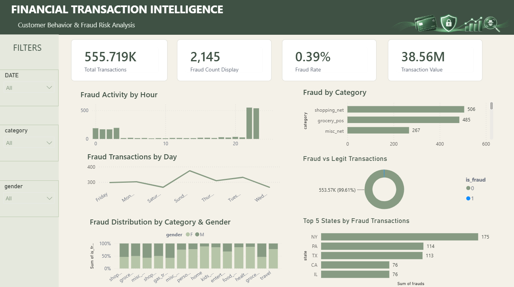

# 💳 FinTech Fraud Analytics
### Financial Transaction Intelligence – Customer Behavior & Fraud Risk Analysis

An end-to-end data analytics project focused on analyzing financial transactions, identifying fraud patterns, understanding customer transaction behavior, and presenting actionable insights through an interactive Power BI dashboard.

---

## 📌 Project Overview

Financial fraud is a major challenge for digital payment systems. This project analyzes transaction data to identify suspicious activities, understand fraud distribution, and explore patterns across transaction categories, time, geography, and customer demographics.

Using Python, SQL, and Power BI, the project transforms raw financial transaction data into meaningful insights that can support fraud monitoring and data-driven decision-making.

---

## 🎯 Objectives

- Analyze financial transaction patterns and customer behavior.
- Identify fraudulent transactions and understand fraud distribution.
- Explore fraud activity across different hours and transaction categories.
- Analyze geographical patterns in fraudulent transactions.
- Compare fraudulent and legitimate transaction characteristics.
- Build an interactive dashboard to communicate key findings.

---

## 🛠️ Tech Stack

| Technology | Purpose |
|---|---|
| Python | Data analysis and exploratory data analysis |
| Pandas | Data cleaning, manipulation and analysis |
| NumPy | Numerical operations |
| SQL | Data querying and analytical operations |
| MySQL | Database management |
| Power BI | Interactive dashboard and visualization |
| Jupyter Notebook | Exploratory analysis and documentation |

---

## 📊 Dataset Overview

The project uses credit card transaction data containing transaction details, customer information, merchant information, transaction amounts, timestamps, and fraud labels.

| Metric | Value |
|---|---:|
| Total Transactions | 555,719 |
| Fraudulent Transactions | 2,145 |
| Legitimate Transactions | 553,574 |
| Fraud Rate | 0.39% |
| Unique Cardholders | 924 |
| Merchants | 693 |
| Transaction Categories | 14 |
| Unique Cities | 849 |

> The raw dataset is not included in this repository due to its large size.

---

## 📈 Dashboard Preview

### Dashboard Highlights

- Total Transaction KPI
- Fraud Transaction Count
- Fraud Rate
- Total Transaction Value
- Fraud Activity by Hour
- Fraud Distribution by Category
- Daily Fraud Transaction Trends
- Fraud vs. Legitimate Transactions
- Fraud Distribution by Category and Gender
- Top 5 States by Fraud Transactions

---

## 🔍 Key Insights

- Fraudulent transactions represent approximately **0.39%** of all transactions.
- Fraud transaction amounts are significantly higher than legitimate transactions.
- The median fraudulent transaction amount is approximately **7.87 times** the median legitimate transaction amount.
- Fraud activity shows noticeable concentration during late-night hours.
- Certain merchant categories contribute a higher number of fraudulent transactions.
- Geographic analysis reveals variations in fraudulent transaction activity across states.

---

## 📂 Project Files

| File | Description |
|---|---|
| `01_data_understanding.ipynb` | Exploratory Data Analysis and data understanding |
| `fintech_analysis.sql` | SQL queries for transaction analysis |
| `FinTech_Fraud_Analytics_Dashboard.png` | Power BI dashboard preview |
| `FinTech_Fraud_Analytics_Professional_Report.pdf` | Detailed project report |

---

## 🔄 Project Workflow

1. Data Loading and Understanding
2. Data Cleaning and Preprocessing
3. Exploratory Data Analysis using Python
4. Transaction Analysis using SQL
5. Fraud Pattern Identification
6. Dashboard Development using Power BI
7. Insight Generation and Reporting

---

## 📑 Project Report

A detailed professional report covering the project objectives, dataset overview, methodology, analysis, key findings, dashboard visuals, and conclusion.

📄 **[View Project Report](FinTech_Fraud_Analytics_Professional_Report.pdf)**

---

## 💡 Skills Demonstrated

- Data Cleaning and Preprocessing
- Exploratory Data Analysis (EDA)
- Python Data Analysis
- SQL Querying and Aggregation
- Data Visualization
- Dashboard Development
- Business Insight Generation
- Analytical Problem Solving

---

## 👨‍💻 Author

**Vivek Mankar**

Data Analytics | Python | SQL | Power BI

---

⭐ If you find this project interesting, feel free to explore the repository.
